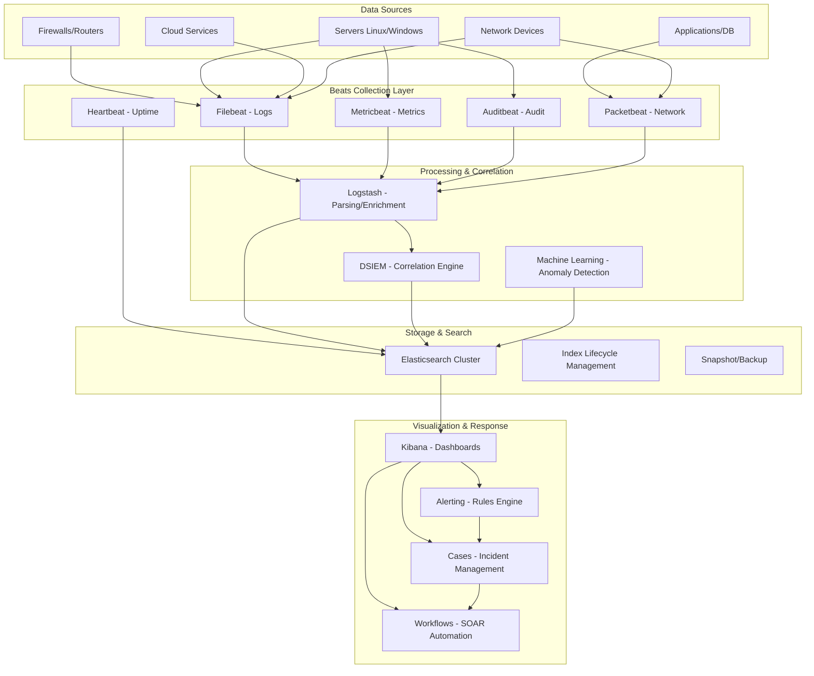
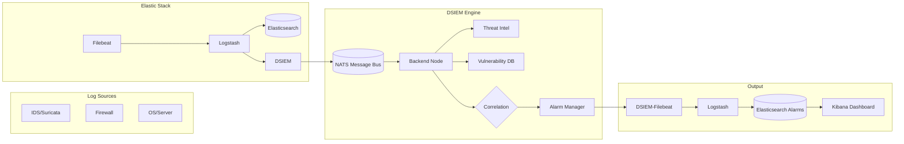

# SIEM ELK Stack 9.4.2 - Hệ Thống Quản Lý An Ninh Mạng

> **Phiên bản:** 9.4.2 | **Hệ điều hành:** Ubuntu 24.04 LTS | **Mô hình:** StandAlone All-in-one | **Bảo mật:** SSL/TLS Certbot

## Mục Lục

- [1. Tổng Quan SIEM](#1-tổng-quan-siem)
- [2. Kiến Trúc Hệ Thống](#2-kiến-trúc-hệ-thống)
- [3. Tính Năng Trong Elastic Stack 9.4.2](#3-tính-năng-trong-elastic-stack-942)
- [4. Thành Phần Cài Đặt](#4-thành-phần-cài-đặt)
- [5. Hướng Dẫn Cài Đặt Nhanh](#5-hướng-dẫn-cài-đặt-nhanh)
- [6. Cấu Hình Chi Tiết](#6-cấu-hình-chi-tiết)
- [7. Quản Lý Hệ Thống](#7-quản-lý-hệ-thống)
- [8. DSIEM - Distributed SIEM](#8-dsiem---distributed-siem)
- [9. Bảo Mật](#9-bảo-mật)
- [10. Xử Lý Sự Cố](#10-xử-lý-sự-cố)
- [11. Tài Liệu Tham Khảo](#11-tài-liệu-tham-khảo)

---

## 1. Tổng Quan SIEM

### 1.1 SIEM là gì?

**SIEM** (Security Information and Event Management) là hệ thống quản lý thông tin và sự kiện an ninh mạng, đóng vai trò trung tâm trong việc thu thập, phân tích, và phản ứng với các mối đe dọa bảo mật. SIEM kết hợp hai công nghệ:

- **SIM** (Security Information Management): Thu thập và lưu trữ dữ liệu log tập trung
- **SEM** (Security Event Management): Phân tích real-time và tương quan sự kiện

### 1.2 Kiến Trúc SIEM ELK

```
+--------------------+     +------------------+     +-------------------+
|   Data Sources     |     |    Ingestion     |     |   Correlation     |
|                    |     |                  |     |                   |
| - Firewalls        |---->| - Filebeat       |---->| - Elasticsearch   |
| - IDS/IPS          |     | - Metricbeat     |     | - DSIEM Engine    |
| - Servers          |     | - Auditbeat      |     | - Machine Learning|
| - Applications     |     | - Packetbeat     |     | - Rules Engine    |
| - Cloud Services   |     | - Logstash       |     | - Threat Intel    |
| - Network Devices  |     | - APM Server     |     |                   |
+--------------------+     +------------------+     +---------+---------+
                                                              |
                                                              v
+--------------------+     +------------------+     +-------------------+
|   Visualization    |     |   Response       |     |   Storage         |
|                    |     |                  |     |                   |
| - Kibana           |<----| - Alerts         |<----| - Elasticsearch   |
| - Dashboards       |     | - Cases          |     | - ILM Policies    |
| - Reports          |     | - Workflows      |     | - Snapshots       |
| - Maps             |     | - SOAR Actions   |     | - Cold Storage    |
+--------------------+     +------------------+     +-------------------+
```

### 1.3 Mô Hình StandAlone All-in-one

Đây là mô hình triển khai phù hợp cho:

- **PoC/Testing**: Kiểm thử và đánh giá năng lực SIEM
- **SMB**: Doanh nghiệp vừa và nhỏ với lưu lượng log <50GB/ngày
- **Lab/Học tập**: Môi trường học tập và nghiên cứu
- **Campus**: Trường học, viện nghiên cứu

**Yêu cầu tối thiểu:**
| Tài nguyên | Tối thiểu | Khuyến nghị |
|------------|-----------|-------------|
| CPU        | 4 cores   | 8+ cores    |
| RAM        | 8 GB      | 16-32 GB    |
| Disk       | 50 GB     | 200+ GB SSD |
| Network    | 1 Gbps    | 1 Gbps      |

---

## 2. Kiến Trúc Hệ Thống

### 2.1 Sơ Đồ Kiến Trúc



### 2.2 Luồng Dữ Liệu

1. **Thu thập**: Beats agents thu thập log/metrics từ các nguồn
2. **Xử lý**: Logstash parse, filter, enrich dữ liệu
3. **Tương quan**: DSIEM phân tích và tương quan sự kiện
4. **Lưu trữ**: Elasticsearch index dữ liệu với ILM
5. **Phân tích**: Kibana visualize và phát hiện bất thường
6. **Phản ứng**: Alerting, Cases, Workflows tự động hóa

---

## 3. Tính Năng Trong Elastic Stack 9.4.2

### 3.1 Elasticsearch 9.4.2

| Tính năng | Mô tả |
|-----------|-------|
| **Vector Database** | Lưu trữ và tìm kiếm vector embeddings cho AI/ML |
| **Piped Query Language (ES/QL)** | Ngôn ngữ truy vấn pipeline mới, mạnh mẽ |
| **Semantic Search** | Tìm kiếm ngữ nghĩa với NLP tích hợp |
| **AutoOps** | Tự động tối ưu cluster performance |
| **Workflows** | Kết hợp script automation với AI reasoning |
| **Frozen Tier** | Lưu trữ dữ liệu lạnh với chi phí thấp |
| **Cross-Cluster Search** | Tìm kiếm liên cluster |
| **ML Inference** | Machine learning inference tại chỗ |
| **Vector Quantization** | Nén vector để giảm dung lượng lưu trữ |
| **RRF (Reciprocal Rank Fusion)** | Kết hợp kết quả từ nhiều truy vấn |

### 3.2 Kibana 9.4.2

| Tính năng | Mô tả |
|-----------|-------|
| **Discover** | Tìm kiếm và khám phá dữ liệu real-time |
| **Dashboards** | Trực quan hóa với drag-and-drop |
| **Canvas** | Tạo presentation từ dữ liệu |
| **Maps** | Bản đồ địa lý cho security events |
| **Security Solution** | SIEM tích hợp: detection, cases, timelines |
| **Endpoint Security** | Quản lý endpoint protection |
| **Cloud Security Posture** | CSPM cho multi-cloud |
| **Elastic AI Agent** | Trợ lý AI cho SOC operations |
| **OSQuery** | Quản lý OSQuery từ Kibana |
| **Uptime** | Synthetic monitoring |
| **Reporting** | Tạo báo cáo PDF/CSV |
| **Alerting** | Rule-based và ML-based alerting |
| **Cases** | Quản lý incident lifecycle |
| **Workflows** | SOAR automation |

### 3.3 Logstash 9.4.2

| Tính năng | Mô tả |
|-----------|-------|
| **HTTP Input** | Nhận dữ liệu qua HTTP/REST |
| **Elasticsearch Integration** | Input/Output/Filter tích hợp ES |
| **JDBC Input** | Kết nối database trực tiếp |
| **Kafka Integration** | Buffer và queue với Kafka |
| **Grok Filter** | Pattern matching cho log parsing |
| **Dissect Filter** | Tách field nhanh hơn Grok |
| **GeoIP Filter** | Enrich IP với thông tin địa lý |
| **Translate Filter** | Tra cứu dữ liệu từ file/ES |
| **Pipeline-to-Pipeline** | Liên kết nhiều pipeline |
| **Multiple Pipelines** | Chạy nhiều pipeline độc lập |

### 3.4 Beats 9.4.2

| Beat | Chức năng | Thu thập |
|------|-----------|----------|
| **Filebeat** | Log files | /var/log, syslog, application logs |
| **Metricbeat** | System metrics | CPU, RAM, Disk, Network, Docker |
| **Auditbeat** | Audit data | File integrity, process, user activity |
| **Packetbeat** | Network packets | HTTP, DNS, MySQL, TLS, etc. |
| **Heartbeat** | Uptime monitoring | HTTP, TCP, ICMP endpoints |
| **Winlogbeat** | Windows events | Windows Event Log (Windows only) |
| **Elastic Agent** | Unified agent | Kết hợp tất cả beats + endpoint security |

### 3.5 APM Server 9.4.2

| Tính năng | Mô tả |
|-----------|-------|
| **Distributed Tracing** | Theo dõi request xuyên service |
| **Service Maps** | Bản đồ dependency giữa services |
| **Real User Monitoring** | Theo dõi trải nghiệm người dùng |
| **OpenTelemetry** | Hỗ trợ OTel native |
| **Code-level Metrics** | Stack traces và profiling |
| **AI/ML Monitoring** | Monitor LLM inference |

### 3.6 Elastic Security Features

| Tính năng | Mô tả |
|-----------|-------|
| **SIEM Detection Rules** | 800+ pre-built detection rules mapped to MITRE ATT&CK |
| **Machine Learning Jobs** | Anomaly detection cho user/auth/network behavior |
| **Endpoint Security** | EDR/EPP tích hợp sẵn |
| **Cloud Security** | AWS, Azure, GCP security posture |
| **Kubernetes Security** | Container security monitoring |
| **Network Security** | Network traffic analysis |
| **Entity Analytics** | Risk scoring cho users và hosts |
| **Timeline** | Investigation workspace |
| **Cases** | Incident management |
| **Osquery** | Live query via Osquery |
| **Threat Intelligence** | Tích hợp TI feeds |
| **Indicators of Compromise** | IOC matching |
| **Immutable Rules** | Rules không thể bị chỉnh sửa trái phép |

---

## 4. Thành Phần Cài Đặt

### 4.1 Danh Sách Scripts

| File | Chức năng | Module |
|------|-----------|--------|
| `s1_install_elk_siem.sh` | Cài đặt toàn bộ ELK Stack + Beats + APM + SSL | **Main Installer** |
| `s2_configure_dsiem.sh` | Tích hợp DSIEM correlation engine | **DSIEM Integration** |
| `s3_verify_debug.sh` | Kiểm tra, debug, quản lý hệ thống | **Management** |

### 4.2 Cấu Trúc Thư Mục

```
C:\siems.cloud.edu.vn\
├── README.md                       # Tài liệu hướng dẫn
├── s1_install_elk_siem.sh          # Script cài đặt chính
├── s2_configure_dsiem.sh           # Script DSIEM
├── s3_verify_debug.sh              # Script quản lý
├── config/
│   ├── elasticsearch.yml           # Cấu hình ES
│   ├── kibana.yml                  # Cấu hình Kibana
│   ├── logstash.conf               # Cấu hình Logstash
│   └── filebeat.yml                # Cấu hình Filebeat
└── docker/
    └── docker-compose-dsiem.yml    # Docker Compose cho DSIEM
```

---

## 5. Hướng Dẫn Cài Đặt Nhanh

### 5.1 Yêu Cầu Trước Khi Cài

- Ubuntu 24.04 LTS Server (mới cài, sạch)
- Domain trỏ về IP server (cho Let's Encrypt)
- RAM tối thiểu 4GB (khuyến nghị 8GB+)
- Disk trống tối thiểu 20GB

### 5.2 Cài Đặt Cơ Bản

```bash
# 1. Clone repository
git clone https://github.com/your-repo/siem.git /opt/siem
cd /opt/siem

# 2. Phân quyền scripts
chmod +x s*.sh

# 3. Export biến môi trường (tùy chọn)
export DOMAIN="siem.yourcompany.com"
export EMAIL="admin@yourcompany.com"
export ELASTIC_PASSWORD="YourStrongPassword123!"

# 4. Chạy script cài đặt (mất 15-30 phút)
sudo ./s1_install_elk_siem.sh

# 5. Cài DSIEM (tùy chọn)
sudo ./s2_configure_dsiem.sh
```

### 5.3 Cài Đặt Nhanh Một Lệnh

```bash
curl -sL https://raw.githubusercontent.com/your-repo/siem/main/s1_install_elk_siem.sh | \
  sudo DOMAIN=siem.yourcompany.com EMAIL=admin@yourcompany.com bash
```

---

## 6. Cấu Hình Chi Tiết

### 6.1 Cổng Kết Nối

| Cổng | Giao thức | Dịch vụ | Mục đích |
|------|-----------|---------|----------|
| 22 | TCP | SSH | Quản trị server |
| 80 | TCP | Nginx/HTTP | Certbot HTTP challenge |
| 443 | TCP | Nginx/HTTPS | Kibana HTTPS (chính) |
| 9200 | TCP | Elasticsearch | REST API (internal) |
| 9300 | TCP | Elasticsearch | Transport (cluster) |
| 5601 | TCP | Kibana | Web UI (internal) |
| 5044 | TCP | Logstash | Beats input |
| 5514 | TCP/UDP | Logstash | Syslog input |
| 8200 | TCP | APM Server | APM intake |
| 4222 | TCP | NATS | DSIEM message bus |
| 8080 | TCP | DSIEM | DSIEM API |

### 6.2 Biến Môi Trường

| Biến | Mặc định | Mô tả |
|------|----------|-------|
| `DOMAIN` | `siem.example.com` | Domain cho Kibana |
| `EMAIL` | `admin@example.com` | Email cho Let's Encrypt |
| `ELASTIC_VERSION` | `9.4.2` | Phiên bản Elastic Stack |
| `ELASTIC_PASSWORD` | auto-generated | Password user elastic |
| `SERVER_IP` | auto-detect | IP server |

### 6.3 Cấu Hình SSL

Script hỗ trợ 2 chế độ:

1. **Let's Encrypt Certbot (khuyến nghị)**: Tự động renew, trusted certificate
   - Yêu cầu domain trỏ về server
   - Port 80 phải mở cho HTTP challenge

2. **Self-signed**: Dùng trong môi trường lab/internal
   - Tạo certificate 10 năm
   - Không cần domain
   - Cần thêm trust store trên client

---

## 7. Quản Lý Hệ Thống

### 7.1 Service Management

```bash
# Kiểm tra health toàn bộ hệ thống
sudo ./s3_verify_debug.sh health

# Xem trạng thái services
sudo ./s3_verify_debug.sh status

# Restart tất cả
sudo ./s3_verify_debug.sh restart

# Xem logs
sudo ./s3_verify_debug.sh logs kibana 100
sudo ./s3_verify_debug.sh logs elasticsearch 50
```

### 7.2 Index Management

```bash
# Liệt kê indices
sudo ./s3_verify_debug.sh indices

# Xóa indices cũ (vd: hơn 90 ngày)
sudo ./s3_verify_debug.sh delete-old 90

# Force merge (tối ưu storage)
sudo ./s3_verify_debug.sh force-merge 1
```

### 7.3 Backup & Restore

```bash
# Tạo backup snapshot
sudo ./s3_verify_debug.sh backup pre-upgrade-20250101

# Liệt kê backups
sudo ./s3_verify_debug.sh list-backups

# Restore
sudo ./s3_verify_debug.sh restore pre-upgrade-20250101
```

### 7.4 Certificate Management

```bash
# Renew Let's Encrypt certificate
sudo ./s3_verify_debug.sh renew-cert

# Kiểm tra SSL
sudo ./s3_verify_debug.sh health
```

### 7.5 Performance Monitoring

```bash
# Performance statistics
sudo ./s3_verify_debug.sh perf
```

---

## 8. DSIEM - Distributed SIEM

### 8.1 Giới Thiệu DSIEM

**DSIEM** (Distributed Security Information and Event Management) là security event correlation engine mã nguồn mở (GPLv3) được phát triển bởi [defenxor/dsiem](https://github.com/defenxor/dsiem). Nó bổ sung khả năng tương quan sự kiện theo phong cách OSSIM cho ELK Stack.

### 8.2 Tính Năng DSIEM

| Tính năng | Mô tả |
|-----------|-------|
| **OSSIM-style Correlation** | Tương quan sự kiện với directive rules |
| **Horizontal Scalability** | Hỗ trợ cluster mode với NATS messaging |
| **Threat Intelligence** | Tích hợp TI lookup (Arkime Wise, Alienvault OTX) |
| **Vulnerability Integration** | Tích hợp Nessus CSV exports |
| **Rate Control** | Kiểm soát events/second (EPS) |
| **Plugin System** | Plugin cho TI và vulnerability sources |
| **Alarms Management** | Web UI basic cho alarm management |
| **Metricbeat/APM Instrumentation** | Monitoring không cần stack riêng |

### 8.3 Kiến Trúc DSIEM



### 8.4 Cài Đặt DSIEM

```bash
# Chạy script DSIEM (sau khi đã cài ELK)
sudo ./s2_configure_dsiem.sh
```

Script sẽ tự động:

1. Cài đặt NATS server cho messaging
2. Tải DSIEM binary hoặc Docker image
3. Cấu hình directive rules (SSH brute force, port scan, malware C2)
4. Tạo Logstash pipeline cho DSIEM events
5. Cài đặt DSIEM systemd service
6. Tạo Docker Compose file cho DSIEM cluster

### 8.5 Cấu Hình Directives

DSIEM directives được lưu tại `/opt/dsiem/conf/directives/`. Mỗi directive là một JSON file:

```json
{
  "name": "SSH Brute Force",
  "enabled": true,
  "priority": 5,
  "timeout": 300,
  "type": "single",
  "rules": [
    {
      "name": "5 failures in 60s",
      "occurrence": 5,
      "timeframe": 60,
      "sources": [{"event_type": "ssh_auth_failure"}]
    }
  ],
  "response": {
    "alarm_level": "high",
    "technique": "Brute Force (T1110)",
    "description": "SSH brute force detected"
  }
}
```

---

## 9. Bảo Mật

### 9.1 Xác Thực và Phân Quyền

- X-Pack Security: enabled
- TLS 1.2/1.3 cho mọi communication
- Built-in users: elastic, kibana_system, logstash_system, beats_system, apm_system
- Role-Based Access Control (RBAC)
- API Keys cho programmatic access

### 9.2 Network Security

```bash
# UFW rules mặc định
ufw status verbose

# Chỉ mở:
# - 22/tcp (SSH)
# - 80/tcp (HTTP - Certbot)
# - 443/tcp (HTTPS - Kibana)
# - 9200/tcp (Elasticsearch - internal)
```

### 9.3 Audit Logging

- Elasticsearch audit logs: access_denied, authentication_failed, security_config_change
- Filebeat collects auth.log, syslog
- Auditbeat provides file integrity monitoring (FIM)
- All logs are indexed and searchable in Kibana

### 9.4 Best Practices

1. **Change default passwords immediately** after installation
2. **Regular backups** of configurations and certificates
3. **Monitor SSL certificate expiry** (auto-renew with Certbot)
4. **Keep system updated** (`apt update && apt upgrade`)
5. **Enable audit logging** in production
6. **Use strong passwords** (auto-generated by script)
7. **Limit network access** with UFW/VPC/security groups
8. **Regular ILM review** for storage optimization

---

## 10. Xử Lý Sự Cố

### 10.1 Elasticsearch Issues

| Vấn đề | Nguyên nhân | Giải pháp |
|--------|-------------|-----------|
| Cannot connect to ES | Port not open, service not running | `systemctl status elasticsearch`, `ufw status` |
| Out of memory | Insufficient heap, high load | Check `jvm.options`, increase RAM |
| Cluster health yellow/red | Replicas not allocated, disk full | Check `_cluster/health`, free disk space |
| SSL handshake error | Certificate expiry, CA trust | `openssl verify -CAfile fullchain.pem fullchain.pem` |

### 10.2 Kibana Issues

| Vấn đề | Nguyên nhân | Giải pháp |
|--------|-------------|-----------|
| Cannot connect to Kibana | Port not open, Nginx not running | `systemctl status kibana nginx` |
| Kibana cannot connect to ES | Wrong credentials, SSL error | Check `kibana.yml`, test with `curl -u elastic` |
| White screen/deployment | Plugin conflict, low memory | Clear browser cache, check Kibana logs |

### 10.3 Logstash Issues

```bash
# Test Logstash configuration
/usr/share/logstash/bin/logstash --path.settings /etc/logstash -t

# View Logstash logs
journalctl -u logstash -n 100 --no-pager

# Check Logstash pipeline
curl -X GET 'http://localhost:9600/_node/pipelines?pretty'
```

### 10.4 Certificate Issues

```bash
# Check certificate expiry
openssl x509 -in /etc/letsencrypt/live/$DOMAIN/fullchain.pem -noout -enddate

# Test SSL connection
openssl s_client -connect $DOMAIN:443 -servername $DOMAIN

# Renew certificate
sudo certbot renew --force-renewal
```

### 10.5 Commands Debug

```bash
# Elasticsearch
curl -sk -u elastic:password https://localhost:9200/_cluster/health?pretty
curl -sk -u elastic:password https://localhost:9200/_cat/indices?v
curl -sk -u elastic:password https://localhost:9200/_nodes/stats?pretty

# Kibana
curl -sk https://localhost:5601/api/status

# Logstash
curl -s http://localhost:9600/_node/stats?pretty

# Filebeat
filebeat test output
filebeat test config
filebeat modules list

# System
ss -tulpn | grep LISTEN
ufw status verbose
journalctl -xe
```

---

## 11. Tài Liệu Tham Khảo

### 11.1 Official Documentation

| Tài liệu | URL |
|----------|-----|
| Elastic Stack Installation | https://www.elastic.co/guide/en/elastic-stack/current/installing-elastic-stack.html |
| Elasticsearch Reference | https://www.elastic.co/guide/en/elasticsearch/reference/current/ |
| Kibana Guide | https://www.elastic.co/guide/en/kibana/current/ |
| Logstash Reference | https://www.elastic.co/guide/en/logstash/current/ |
| Beats Guide | https://www.elastic.co/guide/en/beats/libbeat/current/ |
| Elastic Security | https://www.elastic.co/security |
| APM Server | https://www.elastic.co/guide/en/apm/server/current/ |
| Elasticsearch Hadoop | https://www.elastic.co/guide/en/elasticsearch/hadoop/current/ |

### 11.2 DSIEM References

| Tài liệu | URL |
|----------|-----|
| DSIEM GitHub | https://github.com/defenxor/dsiem |
| DSIEM Installation | https://github.com/defenxor/dsiem/blob/master/docs/installation.md |
| DSIEM Directives | https://github.com/defenxor/dsiem/blob/master/docs/directives.md |

### 11.3 Reference Projects

| Dự án | URL | Mô tả |
|-------|-----|-------|
| AgentK9/ElasticSIEM | https://github.com/AgentK9/ElasticSIEM | Instructions, scripts, and example configurations |
| 0xsynix/SIEM-With-ELK | https://github.com/0xsynix/SIEM-With-ELK | SIEM toolkit with Zeek integration |
| PhDLeToanThang/siem | https://github.com/PhDLeToanThang/siem | SIEM setup scripts |
| PhDLeToanThang/automation#30 | https://github.com/PhDLeToanThang/automation/issues/30 | Bash script guide for SIEM ELK |
| PhDLeToanThang/pentesting_it-audit#8 | https://github.com/PhDLeToanThang/pentesting_it-audit/issues/8 | Design analysis SIEM ELK + DSIEM |

### 11.4 Tools & Utilities

| Công cụ | URL | Mô tả |
|---------|-----|-------|
| Certbot | https://certbot.eff.org/ | Let's Encrypt SSL client |
| NATS | https://nats.io/ | Cloud-native messaging |
| TheHive | https://thehive-project.org/ | SOAR/Case management |
| MISP | https://www.misp-project.org/ | Threat Intelligence Platform |
| Suricata | https://suricata.io/ | IDS/IPS engine |

---

## License

This project is licensed under GPLv3 - see the [LICENSE](LICENSE) file for details.

## Tác Giả

**PhD. Le Toan Thang** - Security Researcher & DevOps Engineer

- GitHub: [@PhDLeToanThang](https://github.com/PhDLeToanThang)
- Blog: https://thangletoan.wordpress.com/

---

> **Lưu ý:** Script này được thiết kế cho môi trường Ubuntu 24.04 LTS với Elastic Stack 9.4.2. Luôn kiểm tra trên môi trường staging trước khi triển khai production.
